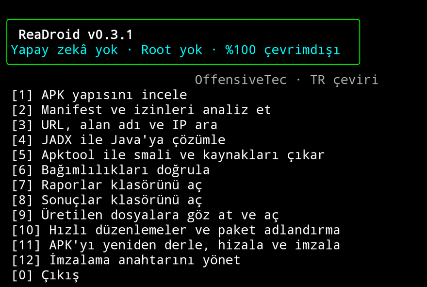

<div align="center">

# ReaDroid — Türkçe

**Android Tersine Mühendislik Araç Kutusu**

Android 12–16 için statik APK analizi ve yeniden derleme.
Termux üzerinde root'suz, çevrimdışı ve yapay zekâsız çalışır.

[](https://github.com/Memati8383/ReaDroid/actions/workflows/tests.yml)
[](https://www.python.org/)
[](https://termux.dev/)
[](LICENSE)
[](locales/tr.json)
[](https://github.com/Mcsd7/ReaDroid)

[**Tek satır kurulum**](#tek-komut) ·
[Menü](#menü) ·
[Uyumluluk](#uyumluluk) ·
[Nasıl çalışır](#nasıl-çalışır) ·
[Sorun giderme](#sorun-giderme)

</div>



> **Bu depo, [Mcsd7/ReaDroid](https://github.com/Mcsd7/ReaDroid) projesinin Türkçe çevirisidir.**
> Orijinal kod, çekirdek mantık ve araç zinciri Mcsd7'ye aittir (MIT, telif OffensiveTec).
> Bu fork'a özgü olan: arayüz çevirisi, otomatik testler, tek komut kurulum ve Türkçe belgeler.

**Diller:** 🇹🇷 [Türkçe](README.md) · 🇬🇧 [English](README.en.md) · 🇵🇹 [Português (upstream)](README.pt.md)

---

## Tek komut

Termux'u açıp şu tek satırı yapıştırın. Betik depoyu kurar, gereken paketleri yükler,
kendini test eder ve ne yapmanız gerektiğini söyler:

```bash
bash -c "$(curl -fsSL https://raw.githubusercontent.com/Memati8383/ReaDroid/main/install.sh)"
```

İlk seferde onay ister (`[e/H]`). Onaylamadan kurmak için:

```bash
bash -c "$(curl -fsSL https://raw.githubusercontent.com/Memati8383/ReaDroid/main/install.sh)" -- -y
```

| Seçenek | Ne yapar |
|---|---|
| `-y`, `--yes` | Onay sormaz |
| `--check` | Hiçbir şey kurmaz, sadece otomatik testi çalıştırır |
| `--dir CAMINHO` | Farklı klasöre kurar (varsayılan `~/ReaDroid`) |
| `--repo URL` | Başka bir depodan çeker |
| `--branch AD` | Farklı branch |
| `--lang tr\|pt` | Kurulum mesajlarının dili |
| `--no-deps` | Paket kurmaz, yalnızca kodu yerleştirir |

`install.sh` **idempotenttir**: tekrar çalıştırmak yeniden kurmaz, günceller. Yerelde
değişiklik yaptıysanız üstüne yazılmaz, uyarır.

Ortam değişkenleri: `READROID_REPO`, `READROID_DIR`, `READROID_BRANCH`, `READROID_LANG`.

---

## Ne yapar

| | |
|---|---|
| ✅ | APK'nın ZIP yapısını, SHA-256 özetini, DEX ve yerel kütüphaneleri inceler |
| ✅ | **İkili `AndroidManifest.xml` (AXML) okur** — saf Python, JADX/aapt2 gerektirmez |
| ✅ | URL, alan adı ve aday IPv4 adreslerini statik olarak tarar |
| ✅ | JADX ile DEX'i yaklaşık Java'ya çözümler |
| ✅ | Apktool ile smali ve kaynakları çıkarır |
| ✅ | `apktool b` + `zipalign` + `apksigner` ile yeniden derler, hizalar ve imzalar |
| ✅ | Manifest'te hızlı düzenlemeler ve **paket adlandırma** (applicationId) |
| ✅ | JSON raporları — yalnızca yerel, telemetri yok |
| ❌ | APK'yı **çalıştırmaz**, davranışını gerçek zamanlı izlemez |
| ❌ | DRM, lisans doğrulaması veya obfuscation'ı aşmaz |
| ❌ | Orijinal APK'yı değiştirmez — her yeniden derleme `builds/` altına yeni dosya yazar |

---

## Menü

Arayüz Türkçedir. Orijinal Portekizce metinler `READROID_LANG=pt` ile açılır.

| # | Türkçe | Portekizce | Ne yapar |
|---|---|---|---|
| 1 | APK yapısını incele | Inspecionar estrutura do APK | ZIP girdileri, özetler, DEX, yerel kütüphaneler |
| 2 | Manifest ve izinleri analiz et | Analisar manifesto e permissões | Paket, sürüm, izinler, bileşenler |
| 3 | URL, alan adı ve IP ara | Buscar URLs, domínios e IPs | Metin taraması |
| 4 | JADX ile Java'ya çözümle | Decompilar para Java com JADX | DEX → Java |
| 5 | Apktool ile smali ve kaynakları çıkar | Extrair smali e recursos com Apktool | Kaynak çıkarma |
| 6 | Bağımlılıkları doğrula | Verificar dependências | Harici araçların durumu |
| 7 | Raporlar klasörünü aç | Abrir pasta de relatórios | `reports/` |
| 8 | Sonuçlar klasörünü aç | Abrir pasta de resultados | `output/` |
| 9 | Üretilen dosyalara göz at ve aç | Explorar e abrir arquivos gerados | Dosya gezgini |
| 10 | Hızlı düzenlemeler ve paket adlandırma | Edições rápidas e renomear pacote | Manifest düzenleme + applicationId |
| 11 | APK'yı yeniden derle, hizala ve imzala | Reconstruir, alinhar e assinar APK | Tam build zinciri |
| 12 | İmzalama anahtarını yönet | Gerenciar chave de assinatura | keystore üret/göster/sil |
| 0 | Çıkış | Sair | — |

Evet/hayır soruları her iki alışkanlığı da kabul eder: `[e/H]` yazısını görüp `e` (evet)
yazan kullanıcı da, `[s/N]` görüp `s` yazan kullanıcı da doğru davranır.

---

## Uyumluluk

Çekirdek yalnızca Python ve standart kütüphaneyi kullanır — `pip install` gerekmez.
Harici araçlar isteğe bağlıdır ve Termux'un deposundan gelir.

| Bileşen | Gereken | Gerçek cihazda doğrulandı |
|---|---|---|
| Python | 3.9+ | 3.14.6 |
| Android | 12–16 | **16 (SDK 36)** |
| Termux | ARM64 | arm64-v8a, kernel 6.6 |
| JDK | 11+ | openjdk-21 (21.0.12) |
| apktool | 2.x veya 3.x | **3.0.3** |
| jadx | — | 1.5.6 |
| aapt / aapt2 | — | 16.0.0.4 (aapt2 2.20) |
| zipalign | `aapt` paketiyle gelir | çalışıyor |
| apksigner | önerilir | Termux 37.0.0 — **v2 + v3 imzası doğrulandı** |

Aşağıdaki zincir uçtan uca gerçek cihazda koşuldu: APK üretimi → 1/2/3 → 5 → 10 → 11 → 12 →
`apksigner verify`. Yeniden derlenen APK, taşınan paket adını ve izni kendi içinde korudu.

> `apksigner` v1 imzasını yalnızca APK'nın `minSdk`'sı istediğinde uygular. ReaDroid şemayı
> tahmin etmez; `apksigner verify` çıktısından **gerçekten uygulanan** şemaları okur ve raporlar.

---

## Nasıl çalışır

```
readroid.py            giriş noktası (python -m readroid da çalışır)
readroid/
  i18n.py              dil katmanı: t("menu.inspect") → locales/tr.json
  axml.py              ikili AndroidManifest.xml okuyucu (saf Python)
  analyzer.py          statik analiz, AXML çözümü, dış araç entegrasyonu
  builder.py           apktool b → zipalign → keytool/apksigner zinciri
  app.py               terminal menüsü
locales/
  tr.json              Türkçe metinler (160 anahtar)
  pt.json              Orijinal Portekizce metinler
tools/
  selfcheck.py         kurulum sonrası otomatik test
  e2e_check.py         rapor üretimini uçtan uca dener
  ui_smoke.py          arayüzü APK olmadan render eder
  extract_strings.py   çevrilmeyi unutulan metinleri bulan linter
  set_repo.py          depo adresi placeholder'ını doldurur
```

**Metinler kodda değil, katalogda.** Ekranda görünen her metin `t("anahtar.alan")` ile gelir.
Anahtarlar anlamsaldır (`menu.inspect`, `analyzer.note.scan`), metnin kendisi değil — upstream
Portekizce metni değiştirdiğinde anahtar yerinde kalır, çeviri bozulmaz. Eksik anahtar kendini
gösterir, Portekizce'ye sessizce düşmez.

**JSON raporlarının anahtarları İngilizce kalır** (makine tarafından okunur); `note`, `warning`,
`message` gibi değerler etkin dilde yazılır. Rapor dosyası adı dilden bağımsızdır:
`app_inspection_20261018_120000.json`.

---

## Raporlar

`reports/` altına, uygulamanın çalıştığı klasörde yazılır:

```json
{
  "tool": "ReaDroid",
  "version": "0.3.1",
  "file_name": "app.apk",
  "sha256": "…",
  "zip_entry_count": 412,
  "dex_files": ["classes.dex"],
  "manifest": { "present": true, "format": "ikili Android XML (AXML)" },
  "note": "Statik inceleme; bir dosyanın varlığı kötü amaçlı davranışı kanıtlamaz."
}
```

---

## Yeniden derleme akışı

1. **5. seçenek** APK'yı Apktool ile çözer (okunabilir smali + kaynaklar).
2. `output/<app>_apktool/` içindeki dosyaları telefondaki herhangi bir metin editörüyle düzenleyin.
   Sıradan ayarlar için **10. seçenek** (hızlı düzenlemeler) veya **paket adlandırma** kullanılır.
3. **10. seçenek** paketi taşır: `smali`/`smali_classesN` klasörleri yeni paket adına taşınır,
   `.smali` dosyaları ve manifest içindeki sınıf referansları güncellenir.
4. **11. seçenek** tek akışta derler, hizalar ve imzalar:
   `apktool b` → `zipalign` → `keytool` (keystore) → `apksigner`.
   Son APK `builds/` altına düşer; depolama izni verilmişse `Downloads/ReaDroid/`'ye de kopyalanır.
5. **12. seçenek** imzalama anahtarını gösterir veya yeniden üretir (ilk derlemede otomatik oluşur).

**Önemli:** yalnızca kendi APK'larınızda veya değiştirmeye yetkili olduğunuz APK'larda kullanın.
Yeniden imzalama orijinal geliştiricinin kimliğini değiştirir; sonuç mağazadaki uygulamanın
yerini almaz. `SECURITY.md` bölümüne bakın.

---

## Sorun giderme

**11. seçenek "Building resources with aapt2" adımında kırılıyor.**
Termux'un `aapt2` paketi bazen kurulu `libprotobuf`'dan yeni bir ABI'ye bağlanmış olur ve
`cannot locate symbol ...TcParser15MpUnknownFields` hatası verir — `aapt2 version` bile
çalışmaz. Bu ReaDroid'ın hatası değildir; apktool 3 kaynakları derlemek için `aapt2`'yi çağırır.
Çözüm kütüphaneyi yükseltmektir:

```bash
pkg upgrade -y protobuf libprotobuf
```

**Menü Portekizce açıyor.** `READROID_LANG=pt` verilmiş demektir. `echo $READROID_LANG` ile bakın,
temizlemek için `unset READROID_LANG`. Varsayılan Türkçedir; Portekizce yalnızca açıkça istenince açılır.

**JADX "JAVA_HOME is not set and no 'java' command could be found" diyor.**
Genelde `jadx` sarmalayıcısının `PATH`'i görememesinden olur. Etkileşimli bir Termux oturumunda
çalışır, ssh/CI gibi sıfır `PATH`'li bir bağlamda çalışmaz. `pkg install openjdk-21` sonrası tekrar deneyin.

**Download klasöründeki APK'lar listede çıkmıyor.** Bir kez `termux-setup-storage` çalıştırın.

**Türkçe karakterler bozuk görünüyor.** `locale` çıktısında UTF-8 yoksa `export LANG=C.UTF-8` deneyin.

**Menü kutusu eski sürümde taşıyordu.** Bu fork'ta kutu içeriğin genişliğinden ölçülüyor ve
32 kolonluk ekranda bile sığar; `tools/selfcheck.py` bunu dört genişlikte test eder.

---

## Testler

```bash
python -m unittest discover -s tests -v      # 36 test
python tools/selfcheck.py                    # ortam + arayüz + sahte APK testi
```

Testler dilden bağımsızdır. Metinlere doğrulama yapan `tests/test_analyzer.py` Portekizce'yi
sabitler; `tests/test_i18n.py` iki katalogun anahtar kümesinin aynı olduğunu, `{placeholder}`
eşleşmelerini, boş çeviri olmadığını ve iki evet/hayır konvansiyonunun da tanındığını doğrular.
CI her iki dili de koşar.

Yeni metin eklerken:

```bash
python tools/extract_strings.py --stats   # t() sarmalamayı unuttuğun metinleri listeler
```

---

## Katkı

`CONTRIBUTING.md` dosyasına bakın. Türkçe ve Portekizce katkılar kabul edilir.
Metin değişikliklerinde kodu değil `locales/*.json` kataloğunu düzenleyin.

---

## Lisans

MIT. `LICENSE` dosyasına bakın.

## Krediler

ReaDroid, isteğe bağlı üçüncü taraf araçları bütünleştiren özgün bir arayüz/otomasyondur. Orijinal
proje [Mcsd7/ReaDroid](https://github.com/Mcsd7/ReaDroid) — telif hakkı OffensiveTec'e aittir.
Bu depo, o projenin `Memati8383` hesabındaki fork'udur; Türkçe çeviri, `tools/` betikleri ve tek
komut kurulum bu fork'a özeldir. JADX, Apktool ve apksigner kendi projeleri, lisansları ve
koşullarıyla ayrıdır:

- JADX: https://github.com/skylot/jadx
- Apktool: https://github.com/iBotPeaches/Apktool
- apksigner (Termux): https://github.com/termux/termux-packages
- Termux: https://github.com/termux/termux-app